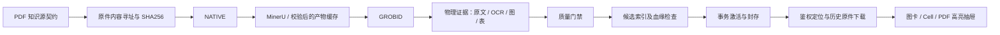

# PDF 多模态原件证据与精确定位

科研 PDF 流水线 `scientific_pdf_v4.0` 将原件、物理区域、引用文本和展示产物分开保存。引用解析由服务器校验版本与几何，前端按返回的四边形绘制高亮。新版本覆盖正文、跨页句子、图及已验证 Panel、表格及 Cell；无法验证的位置保留区域定位与降级原因。

`pdf_evidence@1.0.0` 知识源契约自动选择持久化科研 PDF 流水线，不依赖调用方打开请求级开关。任务由 ARQ Worker 执行，阶段、租约、重试与结果写入 PostgreSQL；`/api/tasks` 读取该流水线的持久化投影。



## 数据契约

| 对象       | 权威身份与用途                                                                           |
| ---------- | ---------------------------------------------------------------------------------------- |
| 原始 PDF   | `tenant_id + source_sha256`；读取历史版本时下载该版本的 `original_pdf` 并复核字节 SHA256 |
| 解析版本   | `parse_revision_id + parser_fingerprint`；冻结解析参数，首次发布设置 `sealed_at`         |
| 物理区域   | `pdf_source_regions`；页面、区域类型、原始文字、父区域和坐标转换                         |
| 引用文本   | `evidence_spans`；来源块、出现位置、引用哈希与归一化匹配方式                             |
| 文本到区域 | `evidence_span_regions`；一个句子允许关联多个区域和多个物理页                            |
| 图资产     | `figure_entities / figure_assets`；原页裁图、区域 ID、哈希、OCR 与 Panel 关联状态        |
| 表与 Cell  | `pdf_tables / pdf_table_cells`；原值、行列、合并关系、表头、脚注和 Cell 几何             |
| 检索版本   | `index_revision_id`；从候选解析自身的 `indexed_markdown` 构建，激活前检查 chunk 血缘     |

字符区间按 Unicode code point 计数；其作用域由 `source_offsets.scope` 指定，例如 `anchor:<id>`，不应将它解释为整页或所有物理区域的局部偏移。同一句话在不同位置出现时保留不同 occurrence。歧义匹配不选择第一个结果。

物理页使用零基 `page_index`，对外同时提供一基页码和 PDF 印刷页标签。规范坐标系是未旋转 CropBox 的左上原点、单位 PDF point：`pdf_crop_unrotated.v1`。每个片段保留页宽高、旋转和 `canonical_to_pdf` 矩阵；前端先转为 PDF 坐标，再使用 PDF.js viewport 转换。禁止用屏幕像素或印刷页标签替代物理页索引。

## 验证与精度

| 精度     | 成立条件                                                                            |
| -------- | ----------------------------------------------------------------------------------- |
| `CHAR`   | 引用在限定来源区域中匹配实际 PDF 字符，返回字符四边形                               |
| `WORD`   | 引用匹配原页 OCR 词序列，返回词框及 OCR 模型、置信度、像素到页面转换                |
| `CELL`   | 表格行列结构与原页单元格边界得到验证，原值保留                                      |
| `PANEL`  | 实际观察的字母与该图题注一致，且在图组中唯一；关联状态为 `VERIFIED_CAPTION_AND_OCR` |
| `REGION` | 只能确认原件区域；不会展示为已验证的逐字或 Cell 定位                                |

文本匹配保留可逆 Unicode 来源映射，处理 NFKC、软连字符、排版引号和已知数学包装。长段落允许受限的排版空白匹配，字母、数字及标点仍必须一致；短基因 ID 与数值不使用这一规则。MinerU 合并跨栏、跨页块时，只用 `middle.json` 中能通过原始文字和矩形唯一验证的来源片段恢复位置。

`unicode-source-map.v3` 对至少 8 个字符且含至少 4 个汉字的引用允许删除 OCR 排版空白，仍要求每个非空白字符一致，并保留来源映射和歧义拒绝。`pdf-region-ocr.v4` 在选区外增加识别上下文，接收的词中心仍须位于原选区内；自适应 DPI 和上下文留白一起计入像素预算。

图片直接从原 PDF 裁取；图注是独立文字证据。OCR 提取的图内文字进入既有证据与词法检索投影，并标明提供者。几何图组用于展示合成整图，不能单凭阅读顺序给成员分配 Panel 字母。表格无可验证 Cell 网格时保留文字或区域定位；跨页续表需要验证剩余行、列数和列对齐，不能仅凭相邻页拼接。

LLM 生成的视觉解释和 LLM-Wiki 派生产品仍属于产品平面，不写回原件证据。

## 接口

`GET /api/workspace/knowledge/locator` 必须通过知识库读取权限。传入 `kb_id / file_id`，并且只选择一种定位方式：

- `span_id`、`anchor_id` 或 `region_id`。
- `figure_label`，可附 `panel_label`。
- `table_id`，可附同时存在的零基 `row_index / column_index`。

推荐同时传 `parse_revision_id / source_sha256` 固定历史引用。响应包含 `source`、`locator`、`semantic_location` 和可引用状态；客户端不提供 bbox 或猜测字符位置。

图卡、Panel 和 Cell 使用后端签发的 `source_selector`。前端校验它与父证据的知识库、文件、解析版本和原件哈希一致；请求构造器只输出一个选择器。图选择器不会混入父证据的 `anchor_id`，Cell 点击保留零基行列索引。图卡选择器省略未确认的 Panel 标签，回到整图区域定位。

`GET /api/workspace/knowledge/download` 使用 `variant=original` 和 `parse_revision_id` 下载历史原件，可附 `source_sha256`。服务器复核原件哈希并返回 ETag。抽屉按解析版本与原件哈希缓存文档，切换文档时取消旧渲染，过期响应不能覆盖新页面。

## 封存、缓存和恢复

版本化迁移增加四张物理证据表、租户 RLS、跨租户及跨版本绑定检查。发布后数据库拒绝修改原件身份、解析参数、原件产物、区域、引用、关联、表格 Cell 和图资产。`sealed_at` 不因索引重建进入 `RUNNING` 而清空，历史引用在重建期间仍可读取。迁移键为 `0080_pdf_physical_evidence` 及 `0104` 至 `0109` 的 PDF 迁移；已有同序号的其他业务迁移使用不同完整键，不应重命名。

完整解析指纹包括流水线、分句器、区域与表格处理版本、坐标及归一化规则、OCR 运行时和实际模型权重哈希、解析选项与 MinerU 阶段配置。缓存逐个复核产物字节哈希；MinerU 阶段缓存另验阶段指纹，原始输出清单保留实际生产者版本。

封存解析仅允许用自身完整缓存重建索引，不重新渲染或改写证据。自身缓存缺失时返回 `PUBLISHED_PDF_CACHE_UNAVAILABLE_CREATE_NEW_REVISION`，需要新建解析版本。影子索引读取候选自身产物，不提前覆盖文件的在线 Markdown 指针；完成 chunk 数量与版本血缘检查后，在行锁中重新读取在线版本，再决定激活。

失败预算最多 3 次实际执行，预算内回到 `PENDING`，由既有对账任务重新排队；耗尽进入 `FAILED`。人工重试重置预算窗口、增加重试 generation，累计 attempt 保留。写入阶段、产物或证据前检查 worker 租约，租约过期或归属丢失拒绝提交。

加密文件、损坏文件和输入预算超限属于确定性 `PdfInputError`，直接进入终态失败，不消耗供应商重试。阶段与质量报告记录明确错误码：`PDF_PASSWORD_REQUIRED`、`PDF_INVALID_DOCUMENT`、`PDF_INPUT_BYTE_BUDGET_EXCEEDED`、`PDF_INPUT_PAGE_BUDGET_EXCEEDED`。默认输入上限 100 MiB、2000 页，分别由服务器环境变量 `PDF_EVIDENCE_MAX_BYTES / PDF_EVIDENCE_MAX_PAGES` 管理，并纳入解析指纹。OCR 区域默认最多 20M 像素，超限明确记录 `BUDGET_EXCEEDED` 并降级。

## OCR 模型与部署

标准 `docker/api.Dockerfile` 在构建期运行 `backend/scripts/provision_pdf_ocr.py`，将三个 PP-OCR 模型下载到 `/opt/yuxi/pdf-ocr`，逐个校验固定 SHA256 后原子替换并设为只读。`PDF_OCR_MODEL_DIR` 可指定企业预置目录；运行期缺失或校验失败会明确降级，不自动下载模型。API 与 Worker 必须使用同一镜像；模型权重、运行时版本和 OCR 参数均进入解析指纹。

```bash
docker compose build api
docker compose up -d api worker
docker exec worker-dev python -c 'from yuxi.knowledge.pdf_evidence.region_ocr import ocr_manifest; assert ocr_manifest()["ready"]'
```

外部工具链仓库暂不可达时，可使用 `docker/pdf-runtime-overlay.Dockerfile` 基于已批准的本地 Yuxi 镜像更新代码和模型。它比较 TOML 解析后的完整 `uv.lock`，允许 Windows 换行差异，但拒绝依赖解析漂移。基线镜像应固定到实际已验证的镜像身份；依赖变化必须恢复标准完整构建。

```bash
docker build --pull=false --build-arg BASE_IMAGE=<已批准的本地镜像> \
  -f docker/pdf-runtime-overlay.Dockerfile -t yuxi-api:0.7.1 .
docker compose up -d api worker
```

## 质量门禁

`quality_vector` 使用 `pdf-quality-vector.v1 / source-occurrences.v2`，分别报告正文、图片、OCR、表格和原始块的分母。没有表格时 Cell 覆盖率为 `null`。

当前 `pdf_evidence_v3.1` 的 FULL 条件包含：来源绑定 100%、正文精确定位至少 95%、图片区域定位 100%、Cell 定位至少 95%、原始块接受率 100%，并要求既有 Markdown 质量校验、有效几何和 GROBID 结构条件。低于门槛仍按真实能力降级为 CONTENT_ONLY / TEXT_ONLY，不伪装为 FULL。激活前比较同版本、同分母的质量向量；能力或指标下降时保留已有在线版本。

这些覆盖率是运行指标，不能替代人工标注的定位准确率。生产验收应为正文、重复文本、旋转及裁剪页、扫描页、图与 Panel、带合并和跨页的表格分别建立金标，报告错误类型、定位 IoU、原值一致性及降级率。

## 部署与验证

开发继续使用现有 Docker Compose。无新增依赖声明；OCR 权重必须预置到运行镜像的 `PDF_OCR_MODEL_DIR`（本镜像为 `/opt/yuxi/pdf-ocr`），缺失明确返回 `PDF_OCR_MODEL_NOT_PROVISIONED`。部署先备份 PostgreSQL 与原件对象存储，运行版本化迁移，再同时更新 api 与 worker；worker 重启后核对两端流水线版本。生产使用已有[数据库最小权限方案](./production-db-least-privilege)，并为原件和封存产物配置对象版本、保留及恢复策略。

已有解析不会因代码升级自动换版本。存量文档升级须通过已有上传/重新解析入口产生新 fingerprint 和 revision，质量通过后切换在线指针，保留已封存的历史版本。本次 RC-G3 激活记录见下节。`evidence-retry` 不应被当作修改封存证据的入口。旧的 `figure-index/rebuild` 对封存解析明确拒绝，图索引升级需要新解析版本。

核心测试在容器中运行：

```bash
docker exec api-dev sh -c 'cd /app && uv run --no-sync --group test pytest test/unit/knowledge/test_pdf_physical_geometry.py test/unit/knowledge/test_pdf_source_binding.py test/unit/knowledge/test_pdf_layout_fragments.py test/unit/knowledge/test_pdf_table_cells.py test/unit/knowledge/test_pdf_shadow_index_source.py test/unit/services/test_pdf_physical_locator.py test/unit/services/test_pdf_sealed_rebuild.py test/unit/routers/test_pdf_locator_acl.py -q'
docker exec api-dev sh -c 'cd /app && PDF_EVIDENCE_RUN_INTEGRATION=1 uv run --no-sync --group test pytest test/integration/knowledge/test_pdf_physical_contract.py -q'
docker exec web-dev sh -c 'cd /app && node src/utils/__tests__/pdfHighlight.spec.js && npm run build'
```

PG 集成夹具使用回滚事务，覆盖原件→解析→数据库→定位、封存写保护、跨版本绑定、非绕过 RLS 的租户隔离、实际 OCR 和封存索引重建。索引重建编排测试替换向量写入及血缘外部调用；影子索引自身产物读取与哈希校验另有单测。完整生产金标准确率仍需独立标注语料验收。

2026-10-09 早期验证：199 项相关单元回归通过，最终租约收口后的 13 项服务回归及 3 项 PG 集成再次通过；前端高亮测试、相关 ESLint/Prettier 与生产构建通过。7 个相关 ORM 模型对照在线 `information_schema` 无列、空值约束或时区漂移。本次变更范围 Ruff 通过；整个 `manager.py` 仍有 8 项既有 channel/browser SQL 长行告警，不属于 PDF 改动。

上述早期回归与只读审计没有激活候选版本；本次后续激活结果见下节。

真实 OsMYB73 18 页论文使用已保存的 MinerU 3.4.4 原始输出只读重放：370 个物理区域、719 个证据单元、51 个视觉区域；符合正文分母的 370 个出现位置中，363 个通过精确定位验证，覆盖率 **98.1081%**。全类型单元精度分布为 CHAR 633、WORD 58、REGION 28；51 个图片区域均有定位，73 次区域 OCR 均完成。7 个正文单元因转录字符不一致等原因保留降级；该论文没有表格，不能据此推断真实论文 Cell 准确率。跨页原句在原始 PDF 上的高亮已抽查。重放刻意跳过 GROBID，结果不冒充完整供应商全链验收。

只读审计脚本 `backend/scripts/audit_pdf_physical_evidence.py` 的 `--diagnostics --snapshot` 会输出报告、完整候选 article 与跨页高亮 PNG。输出建议放在容器 `/app/saves/`，对应宿主 `docker/volumes/yuxi/`；报告及原文快照按内部资料保护。

## 2026-10-09 工作流激活验收

离线矩阵涵盖电子、中文、双栏、旋转、裁剪、英文扫描、中文扫描、混合、跨页表格和加密文件，并检查损坏输入、文件/页数预算和 OCR 像素预算。生成器以 PyMuPDF `rotation_matrix` 与实际页面大小独立生成渲染坐标，不调用被测几何转换。续表实际分布在两页，验证 8 个 Cell，以及续页 19.8、27.1 的原值、区域归属和 CELL 精度；`pdf-table-cells.v3` 容纳坐标舍入造成的边线偏移，仍要求行、列及对齐唯一匹配。另有真实 ONNX 推理的英文扫描、中文扫描和混合 PDF 全流水线测试；矩阵是有限变体的契约回归，不代表任意文件均有相同准确率。

RC-G3 的 OsMYB73 18 页原件在 2026-10-09 15:31（Asia/Shanghai）激活 `spr_ca11a6b1fa1efac96e679ce2f87ae64af5c54472`，状态 `INDEXED_FULL` 且已封存。七阶段完成；MinerU 复用已校验的真实产物，GROBID、物理证据、质量、索引和激活实际执行。模型已预置，OCR **73/73 READY，0 unavailable**。落库 **633 CHAR / 58 WORD / 27 REGION**，共 718 个证据单元；正文出现位置精确覆盖 **363/370 = 98.1081%**。376 个物理区域覆盖 18 页，全部带页标签；24 个图资产通过 Panel 双确认。

实际 HTTP 验证通过 CHAR、WORD、整图、PANEL、原件 SHA256/ETag、激活后旧版原件下载、错误哈希拒绝、多选择器拒绝和未认证拒绝。可复跑 `backend/scripts/verify_pdf_evidence_workflow.py`：令牌只从指定环境变量读取，报告不包含令牌；可附 `--historical-revision` 验证激活后旧原件下载。此论文没有表格，真实论文的 CELL 准确率不由它证明；CELL 已有合成跨页矩阵与真实 PostgreSQL 原件/定位夹具验证。完整聊天浏览器点击验收尚未完成，验收页在服务重建期间退出登录，需恢复现有账号后继续。

最终容器回归：知识与 PDF 服务/路由 **1318 passed、1 skipped**；真实 PostgreSQL 与 ONNX OCR 集成 **6 passed**。跳过项为实时 MinerU 图片解析测试，原因是 MinerU 服务未启动；本次 RC-G3 的 MinerU 阶段复用真实产物，不声明实时 MinerU 服务验收通过。前端定位请求、图卡与高亮三个测试脚本、相关 ESLint/Prettier、生产构建，以及改动范围 Ruff 均通过。JUnit 和 HTTP 报告保存在容器 `/app/saves/pdf-workflow-junit.xml`、`pdf-integrations-junit.xml` 和 `pdf-workflow-live-verification.json`，对应宿主 `docker/volumes/yuxi/`。API 与 Worker 使用同一镜像且健康。标准完整构建受到外部工具链镜像仓库 TLS 超时阻塞，本次使用依赖锁无漂移的本地基线 overlay 完成构建、部署与上述验证。

```bash
docker exec api-dev sh -c 'cd /app && PDF_EVIDENCE_RUN_INTEGRATION=1 PDF_EVIDENCE_RUN_OCR=1 uv run --no-sync --group test pytest test/integration/knowledge/ -q'
docker exec web-dev sh -c 'cd /app && node src/utils/__tests__/pdfLocator.spec.js && node src/utils/__tests__/figureCard.spec.js && node src/utils/__tests__/pdfHighlight.spec.js'
# 将脚本复制到容器后，使用已有测试令牌（不要把令牌写入命令或文档）：
python verify_pdf_evidence_workflow.py --kb-id <kb> --file-id <file> --output <report.json>
```

## 回答中的原句与图表关联（2026-10-09）

普通知识库问答也执行原句关联工作流：检索证据 → 活动版本的真实原文锚点与 SHA 校验 → Figure/Table 编号解析 → 同租户、同文件、同解析版本的一跳题注召回 → 冻结引用池 → 回答门禁 → 原文、图卡、表卡分别发布 → PDF 定位。原文只从数据库锚点读取；模型写出的编号不会触发跨文献资产搜索。

支持 `(Figure 2)`、`（Figure 2）`、`[Figure 2, Table 1]`、`Tables 1 and 2`、`Figures 2A–2C`、`Fig. 2(a)`、补充图表和中文编号。复数 `Tables` 与补充表前缀 `S` 分开解析。范围必须整组可核验且预算足够才签发，不能只为首项生成芯片。代码围栏、行内代码、HTML、已有链接和 Markdown 表格不插入图表链接；前端从 Markdown 文本 token 生成锚点，保持链接不嵌套。

关联报告 `source_references` 随检索契约冻结。每轮最多 16 个原文载体、8 个不同文件/版本/图表目标；每载体最多 32 个提及，候选题注扫描上限 4096。歧义、缺失和预算限制保留明确状态。题注匹配 `RESOLVED` 与图片/结构化表格可展示性分别记录，不能因为找到 Figure/Table 编号就宣称资产已核验。副通道失败保留已核验的原始检索证据并记录 UNAVAILABLE。

已在最终回答中实际引用的原文载体，通过 additive `citation_ready.source_quotes[]` 发布。字段包括 `quote`、`quote_hash`、物理页码、版本和原件 SHA、`anchor_id`、locator fragments、关联目标与视觉发布状态。原句用纯文本展示和复制，保留括号、换行及原始字符；原文查看沿用鉴权 PDF 抽屉。全文段落的定位可以是 REGION，句子级 CHAR/WORD 与整段区域精度须分别报告。未确认的 Panel 回到整图或题注，并显式披露。

SSE 压缩白名单、Web 流式桥接、消息历史保存和桌面 Rust/TypeScript 接收及本地历史均同步支持该字段。桌面端兼容 wire snake_case 与本地存档 camelCase，恢复引用、图卡、图表锚点和表格的完整身份；旧图卡缺少可选 selection 字段时仍保留题注，取图继续检查身份四键。桌面端原文卡提供逐字展示与复制；交互 PDF 定位入口仍是 Web 证据抽屉。无新增数据库列、依赖或协议 major。旧解析不会因代码更新自动升级，存量 PDF 需要重解析并通过质量门后才具备 v4 的物理定位能力。

本轮验证：知识库及定位回归 1330 通过、1 项外部 MinerU 测试跳过；服务回归 131 通过；范围原子签发收口后渲染/关联/契约回归 302 通过（各集合有重叠，不相加）。Web 生产构建及五组 Node 断言通过，桌面 TypeScript 构建与 88 项前端测试通过。Rust GNU 全目标严格 Clippy 与格式检查通过，最终原生库回归 **116 passed、0 failed**，包含原文载荷、完整附件历史、压缩 SSE 和迁移兼容测试。SQL 迁移工作区字节恢复为仓库既定 LF，无迁移 SQL 内容变更。验证使用本机已有 GNU 工具链，并仅为生成的测试程序补充 Common Controls v6 manifest；可复跑本地辅助脚本 `D:/yuxi/tmp/verify-pdf-desktop-native.ps1`。默认 MSVC 安装包构建仍缺 `link.exe`，本轮未生成安装包。浏览器工具未能连接本地验收页，真人点击验收仍未完成。

真实 RC-G3 第 3 页两处含括号引用的正文段落已验证原句 SHA 不变，Figure 2 图卡关联到第 5 页，已确认 Panel 返回 PANEL，未确认 Panel 明确回到整图，缺少图像资产的补充图仅发布题注状态。整段原文的本次定位为 REGION，不宣称整段达到字符精度。实测报告为 `docker/volumes/yuxi/pdf-answer-reference-verification.json`。该论文没有表格，不能据此宣称真实 Table/Cell 金标准确率已经完成验收。

生产补充能力见 [Figure/Table 图文并联生产发布手册](./figure-table-production-runbook)：管理员可盘点并显式升级旧 PDF；检索关联和最终发布分别写入计数型质量轨迹；表格验收脚本将金标绑定活动原件 SHA256，并分别门禁 Cell 坐标与逐字原值。它们用于形成可运营、可审计、可回滚的发布流程，不改变“真实浏览器点击和真实论文表格金标未完成前不得标记 GA”的边界。

```bash
docker exec api-dev uv run --no-sync python scripts/verify_pdf_answer_references.py --kb-id <kb> --file-id <file> --output /app/saves/pdf-answer-reference-verification.json
docker exec api-dev uv run --no-sync --group test pytest test/unit/knowledge/test_source_reference_workflow.py test/unit/services/test_source_reference_publication.py test/unit/services/test_agent_run_contract_fixtures.py -q
docker exec web-dev sh -c 'node src/utils/__tests__/authorityLinks.spec.js && node src/utils/__tests__/sourceQuotes.spec.js && node src/utils/__tests__/figureCard.spec.js'
```
